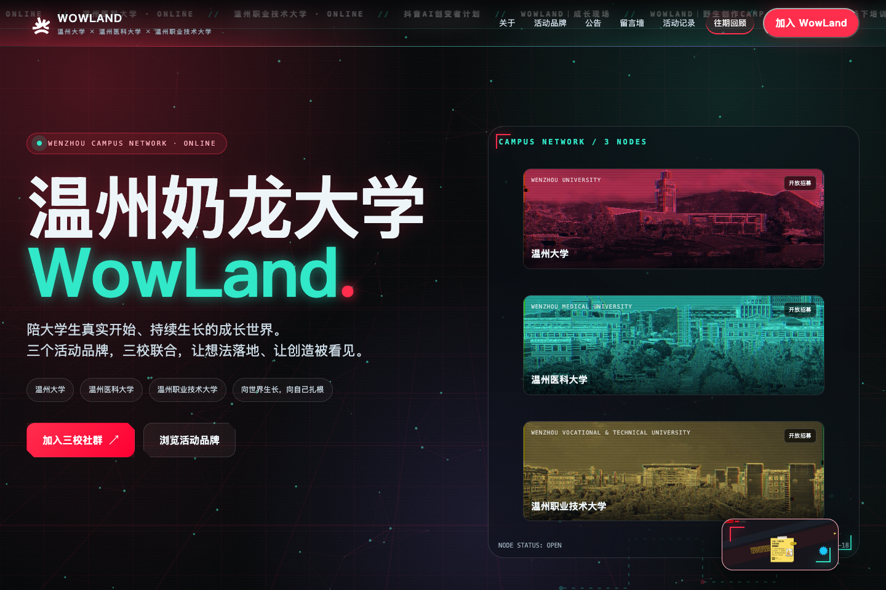

# WowLand Web

温州奶龙大学 WowLand 赛博朋克内容站。项目包含可直接运行的静态网站，以及前期页面分析与设计记录。

## 网站预览



本地运行：

```bash
cd wowland-neon
python3 -m http.server 8080
```

然后打开 <http://127.0.0.1:8080>。

## 项目结构

```text
.
├── wowland-neon/        # 网站成品：HTML / CSS / JavaScript / 图片 / 预览截图
└── website-analysis/    # 参考站点分析、页面结构、交互与实现计划
```

## 网站内容

- `wowland-neon/index.html`：页面结构
- `wowland-neon/styles.css`：视觉系统与响应式样式
- `wowland-neon/app.js`：渲染、导航、粒子、公告与活动记录
- `wowland-neon/data.js`：公告、活动、三校信息、品牌、资源和 FAQ
- `wowland-neon/assets/`：图片、二维码与宣传物料
- `wowland-neon/screenshots/`：桌面、平板和手机端预览

网站为纯静态项目，无需构建步骤，可部署到 GitHub Pages、Vercel、Nginx 或其他静态托管服务。

## 设计分析

`website-analysis/` 中包含参考站点的页面、组件、交互、数据接口、响应式与无障碍分析，以及后续实现计划。
