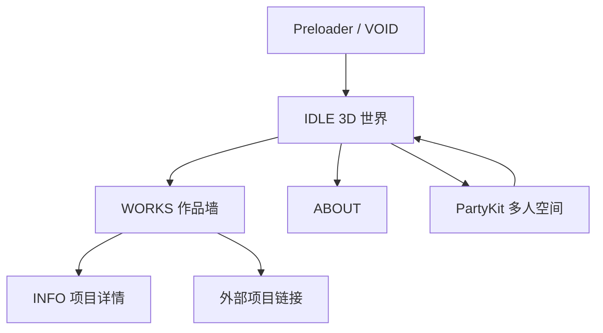

# 页面与信息架构

## 页面清单

| ID | 名称 | 类型 | 路由/入口 | 访问条件 | 主要内容 | 主要操作 | 状态 |
|---|---|---|---|---|---|---|---|
| P-001 | 首页 / 3D 世界 | 单页状态 | `/` | 公开 | 3D 化身、环境、作品视频墙、说明 | 移动、跳、切换 Works / Info / About | [已观察] |
| S-001 | VOID | 初始化状态 | `/` | 资产预载完成前 | 黑色 preloader | 等待 | [已观察] |
| S-002 | IDLE | 3D 漫游 | `/` | 无 | 3D 化身、SMSY 标题、多人在线角色 | WASD/方向、跳、F 互动、菜单切换 | [推测] |
| S-003 | WORKS | 作品墙 | `/` | 菜单或运行时状态 | 25 个项目循环视频、标题、标签、详情、外链 | 滚动 / Q/D / 左右键、点击 Infos/Visit | [已观察] 静态数据 |
| S-004 | INFO | 项目详情覆盖状态 | `/` | Works 中选中项目 | 项目长说明 | 返回 | [推测] |
| S-005 | ABOUT | 关于 | `/` | 菜单 | 个人介绍、联系方式、credit | 链接跳转 | [已观察] CSS/DOM 样式线索 |
| EXT-001~025 | 外部作品页 | 外部页面 | `projects-index.json` | 各站点自身权限 | 项目案例 | 外链打开 | [未覆盖] |

## 页面关系

## 结论

- 路由没有随状态变化；全部状态在 `/` 内维护。证据：加载后 URL 保持 `/`，代码状态枚举 `VOID/IDLE/WORKS/INFO/ABOUT`。[已观察+静态]
- 刷新会重新进入 preloader；没有观察到项目筛选或选中项目写入 URL。[已观察/待确认]
